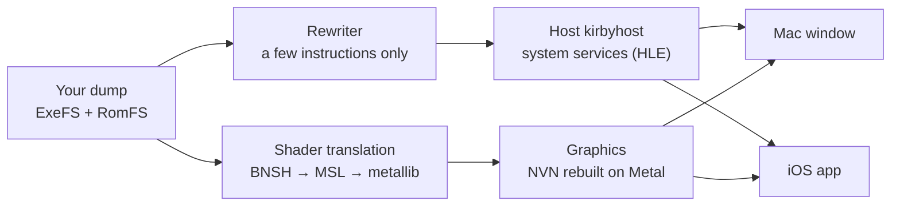

# nvn-metal

**Run your own Switch copy of Kirby and the Forgotten Land natively on Mac and iPhone.** Not an emulator: the game's own ARM64 code runs directly on Apple chips, and the Switch's NVN graphics API is rebuilt on Metal.

Platforms: Mac (Apple silicon, playable) · iPhone (iOS 26+, in development) · Game version: v1.0.0 · English / 中文 · License: MIT · **Bring your own game files**

中文：[README.md](README.md)

<!--
Host screenshots as GitHub Release assets (as d2r-mobile does), then replace this with the real link:
<p align="center"></p>
-->

| 60 fps | 0 emulated instructions | 16,985 | 2 players |
|:---:|:---:|:---:|:---:|
| level frame rate on the Mac (30 originally) | it runs the original program | shaders, all translated to Metal ahead of time | local co-op on the Mac, one controller each |

## Legal

**You must own the game.** Use this project only with a game you bought and data dumped from your own Switch. This is an independent, non-commercial project. It is not affiliated with, endorsed by, or sponsored by Nintendo. Kirby and Nintendo Switch are trademarks of Nintendo.

- **No game content is included or distributed**: no game program, art, text, audio, shaders or keys, and **no decryption code**: getting files out of a game dump is left to the external tool hactool, with keys from your own console. Everything the game needs is made on your own computer from files you dumped yourself.
- What the repository holds is interface information that makes the port work: patch code, symbol names, addresses, shader keys and counts; see [`analysis/`](analysis) and [NOTICE.md](NOTICE.md).
- The app and work directory you build contain game content. They are for your own use only; **do not share them**.
- Whether dumping game data is legal depends on where you live; check and follow your local laws.
- **Issues and pull requests that contain or ask for game files, keys or builds will be deleted.**

Apple, Mac, iPhone and Metal are trademarks of Apple Inc.; this project is not affiliated with Apple.

## What this is, and isn't

**It is:**

- A technical exploration. The Switch and Apple chips are both ARM64: can a Switch game's program run on a Mac or an iPhone without an emulator? Kirby, a complete 3D commercial game that uses NVN fully, is the test case.
- The game's program **runs as-is**. Only the few instructions that cannot execute under the Apple kernel are rewritten, and every rewrite is checked for equivalence. Syscalls, files, audio and input are handled by a small host that implements the SDK functions (HLE); NVN is reimplemented on Metal; shaders are translated to Metal ahead of time.
- Built on the generic host and graphics layer of [d2r-mobile](https://github.com/jhaizhou-ops/d2r-mobile) (Diablo II: Resurrected on iOS). What Kirby needs lives here as a patch and separate files.

**It isn't:**

- An emulator, cloud gaming or streaming.
- A source of builds or game files.
- Online play: the game runs fully offline.

## Status

| Feature | Mac (Apple silicon) | iPhone |
|---|---|---|
| Playing levels | ✅ | ✅ first 3D level |
| Frame rate | ✅ 60 fps in levels (30 originally; `KIRBY_FPS=30` to go back) | 30 fps (original) |
| Game sound | ✅ | 🚧 same fix as the Mac, not yet verified on device |
| Cutscenes, tutorial clips | ✅ hardware VP9 + Vorbis audio | 🚧 libvpx software decoding wired up, to be verified on device |
| Controls | ✅ remappable keyboard, Xbox / PS / Switch Pro controllers | ✅ on-screen pad + physical controllers |
| Local co-op | ✅ separate keys and controller for 1P / 2P (joining not tested yet) | — |
| Stutter when walking or in new areas | ✅ mostly gone with async pipelines | 🚧 fix ready, not yet verified on device |
| Rendering | ✅ | 🚧 garbled textures in the city, under investigation |
| Memory | ✅ no issues seen | 🚧 only ~145 MB headroom |

The Mac build can be played from the start; the iPhone reaches the first level and is still being worked on for stutter, textures and memory. See [Roadmap](#roadmap).

## Measurements

| Item | Reading |
|---|---|
| Mac level frame time | p50 **16.67 ms** (33.33 ms originally), about 4 ms of GPU per frame |
| Mac stutter (same save, same key script, A/B, 100 s each) | pipeline stall time 527 → **79 ms**, worst frame 348 → **94 ms** |
| Mac cutscenes | 1080p VP9 hardware decode, about 2.8 ms per frame |
| iPhone level | steady 30 fps standing still, about 18.6 ms of GPU per frame in 1080p mode |
| Shader library | all 16,985 shaders, plus about 15,000 integer variants; only 10 geometry shaders skipped |
| Rewriting | `main`, `sdk` and `subsdk0` all pass the structure and equivalence checks |

<sub>Mac: M5 (10 cores), macOS 27, 2026-10-22 to 10-23. iPhone: iPhone 16 Pro Max, iOS 27.2, 2026-10-17.</sub>

## How it works



| Part | Where | What it does |
|---|---|---|
| Import and rewriting | `tools/`, upstream `dm/tools/patch_nso.py` | Imports your dump; rewrites only thread-pointer, syscall and timer instructions, leaving everything else byte for byte, then checks each rewrite |
| Host | `host/`, upstream `dm/host` | Loads the rewritten program and implements the SDK functions it calls: files, audio, controllers, time, video |
| Graphics | upstream `dm/gfx` + `patches/` | NVN on Metal; the 46 interfaces Kirby adds are in the patch |
| iOS app | `ios/` | App shell, on-screen pad, build and install |
| Records | `analysis/`, `reports/`, `docs/` | What each task did, how to reproduce it, and the numbers |

**Why you can trust it:** every step has a reproducible check. The rewrite of the three modules has structure and equivalence checks (`tools/structck_kirby.py`, `tools/equiv_kirby.py`); the import tools have regression tests (`tools/test_extractors.py`); the host C code has an arm64 Apple-target syntax check (`tools/syntax_check.py`); performance changes come with A/B numbers. There is one report per task in [`reports/`](reports).

## Getting started

You need **your own copy of the game**: Kirby and the Forgotten Land v1.0.0 for Switch (title ID `01004D300C5AE000`, no update).

**One command (Mac):**

```bash
tools/setup_mac.sh <your dump.xci or .nsp> <your prod.keys>     # or: tools/setup_mac.sh --dump <ExeFS dir> <RomFS dir>
```

It runs steps 1–4 of the table below, builds the host, does a 30-second headless self-test and packages a double-clickable `Kirby Host.app`; if it is interrupted, run the same command again and it resumes. About 1.5 hours in total.

> **Recommended: hand it to an AI assistant.** Open this repository in Claude Code, Codex or another assistant, tell it where your own game dump and `prod.keys` (or an already exported ExeFS / RomFS) are, and ask it to follow [docs/ai_install.en.md](docs/ai_install.en.md): that page is written for AI assistants and covers checking the machine, running the command above and what to do when something fails.

| Step | What | How long |
|---|---|---|
| 1. Get the game files | With a game dump (`.xci` / `.nsp`) and `prod.keys`: `tools/extract_game.sh <dump> <prod.keys>` unpacks it with hactool, checks that it is v1.0.0 and imports it. With ExeFS / RomFS already exported by nxdumptool or similar: import with `tools/import_dump.py` | 10–20 minutes |
| 2. Upstream | Check out d2r-mobile at `6a2474d` and apply `patches/d2r-mobile-kirby.patch` | 1 minute |
| 3. Rewrite | Rewrite and check the three modules | a few minutes |
| 4. Shader library | Translate, then compile macOS metallibs (about 38,000 compiles) | about an hour on an M5, once |
| 5. Play | Mac: double-click `~/kirby-work/Kirby Host.app` (built by `tools/mac_app.sh`), or `make -C host && host/run_mac.sh`; iPhone: `ios/run.sh build && ios/run.sh install && ios/run.sh run` | — |

Full commands for every step are in [docs/build.md](docs/build.md) (Chinese; the commands themselves are language-neutral). Keys, saves, sound and video on the Mac: [docs/mac.en.md](docs/mac.en.md). iPhone signing and install: [ios/README.md](ios/README.md).

**You need:** an Apple silicon Mac with Xcode 26 (the graphics layer uses Metal 4); Homebrew `dotnet spirv-cross llvm`; Python 3 with `capstone lz4 zstandard unicorn`; to read a game dump also [hactool](https://github.com/SciresM/hactool) (build with `make`, put it on `PATH`). For the iPhone also `xcodegen`, the Metal toolchain and an Apple ID (a free one works; re-sign every 7 days).

**Expect a brief hitch the first time you reach a new area**: render pipelines not seen before are built on the spot. On the Mac they are built in the background by default and that frame is skipped; pipelines you have played through are recorded and prebuilt at the next launch.

## Known limitations

| Item | Status |
|---|---|
| Game version | v1.0.0 only; rewrite rules and addresses are tied to the build ID |
| `tools/setup_mac.sh` | new on 2026-11-04, its flow (skipping, resuming, failures in each step) tested only in a mock macOS environment; every command in it ran on an M5 on 2026-10-22, but the script as a whole has not yet been run from scratch on a real Mac |
| `tools/extract_game.sh` | new on 2026-10-30, modeled on d2r-mobile, tested only against a mock hactool; the `.nsp` title-key step in particular is unverified, so reports either way are welcome. The verified path is an exported directory plus `import_dump.py` |
| iPhone models | tested only on an iPhone 16 Pro Max. Since 2026-11-04 the build targets A14 (Metal 4's minimum; it was A18), so A14–A17 phones should install, untested; phones with less than 8 GB of memory are likely not enough |
| iPhone memory | a free Apple ID lacks the increased-memory entitlement, so headroom is tight; a paid developer account helps |
| iOS video | iOS has no VP9 hardware decoder entry point; since 2026-11-04 `ios/run.sh build` bundles libvpx software decoding, matched byte for byte against ffmpeg on Linux, speed on the phone not yet measured (`KIRBY_VPX=0` falls back to no-op playback) |
| Geometry shaders | 10 skipped |
| Online play | out of scope |

## Roadmap

**Near term: bring the iPhone up to the Mac**

- [ ] Verify async pipelines and startup prewarm on device to fix walking stutter
- [ ] Track down garbled textures in the city (suspected wrong shader variant for skinned models)
- [ ] Fix the leak when `nvnTextureInitialize` reinitializes, and cut memory use (fixed 2026-11-04, to be checked against on-device memory stats)
- [ ] Cutscene video on iOS: software VP9 decoding (libvpx wired up 2026-11-04, speed on device to be checked)
- [ ] Screenshot orientation, depth clamp (both changed 2026-11-04, to be verified)

**Medium term: make it installable by others**

- [ ] One command from a dump to a playable build, plus install notes written for AI assistants (2026-11-04: `tools/setup_mac.sh` and [docs/ai_install.en.md](docs/ai_install.en.md) exist; to be run from scratch on a real Mac)
- [ ] A double-clickable Mac `.app` with its own window title and menu (2026-11-04: `tools/mac_app.sh` and `host/kirby_app.m` exist, to be verified on a real Mac; the package only works on the Mac that built it)
- [ ] A shared pipeline list: everyone's recorded `pso_user.tsv` (pipeline keys and formats only, no game data) merged into the repository so nobody stutters in a new area (2026-11-04: the mechanism exists, `pso/shared.tsv` + `tools/pso_merge.py`; the list is still empty, waiting for the first data)
- [ ] More iPhone models (A16 / A17) (2026-11-04: build target lowered to A14, awaiting real tests)
- [ ] Test the local co-op join flow

**Long term**

- [ ] Catch up with the latest d2r-mobile `main` (the patch currently conflicts in 6 files)
- [ ] Updated game versions
- [ ] iPad

## Contributing and feedback

- Open an issue with your machine, OS version, how far you got, and the log (Mac: `~/kirby-work/mac/runN.txt`; iPhone: the app's `Documents/boot.txt`).
- Results on other models, working or not, are welcome.
- After playing a while, share your pipeline list: `python3 -I tools/pso_merge.py add ~/kirby-work/mac/pso_user.tsv`, then send the updated `pso/shared.tsv` as a PR (shader keys and pipeline formats only, validated line by line). Others then won't stutter the first time they reach those scenes.
- To change code, start with the rules and debugging notes in [docs/development.en.md](docs/development.en.md).
- Once more: **do not attach or ask for game files, keys or builds in issues or PRs.**

## Documentation

| Doc | Covers |
|---|---|
| [docs/ai_install.en.md](docs/ai_install.en.md) | Install notes for AI assistants: one command to a playable build, and what to do when it fails |
| [docs/build.md](docs/build.md) | Full commands to build on a Mac from your own dump, i.e. what `tools/setup_mac.sh` does (Chinese) |
| [docs/mac.en.md](docs/mac.en.md) | Playing on the Mac: keys, co-op, saves, sound, video, 60 fps, stutter |
| [ios/README.md](ios/README.md) | iOS app: signing, building, installing, pushing the RomFS (Chinese) |
| [docs/development.en.md](docs/development.en.md) | Development rules and iPhone status ([full Chinese version](docs/development.md)) |
| [docs/handoff.en.md](docs/handoff.en.md) | Continuing development on another computer |
| [TASKS.md](TASKS.md) · [reports/](reports) | Task list and per-task reports (Chinese) |

## Acknowledgements

- **[d2r-mobile](https://github.com/jhaizhou-ops/d2r-mobile)** (MIT) developed this way of running Switch games natively: the NSO rewriter, the host and the NVN-on-Metal layer come from its generic parts.
- **Ryujinx** (MIT): the upstream shader translator `dmsh_xlate` uses its shader translation code.
- **[SPIRV-Cross](https://github.com/KhronosGroup/SPIRV-Cross)** (Apache-2.0): SPIR-V to Metal Shading Language.
- **[stb_vorbis](https://github.com/nothings/stb)** (public domain / MIT): Vorbis audio in cutscenes.
- **[libvpx](https://chromium.googlesource.com/webm/libvpx)** (BSD-3): software VP9 decoding for cutscenes on iOS; `ios/tools/build_libvpx.sh` builds it from source when packaging, not shipped with this repository.
- **[hactool](https://github.com/SciresM/hactool)** (ISC): `tools/extract_game.sh` uses it to read your game dump; it is not shipped with this repository.
- **[MacNativeGames](https://github.com/ly05010419/MacNativeGames)**: another project built on d2r-mobile that brings several Switch games to the Mac; this README and the shared-list idea follow its lead.

## License

MIT, see [LICENSE](LICENSE). Parts derived from d2r-mobile are Copyright (c) 2026 jhaizhou; the Kirby port is Copyright (c) 2026 MayBAMemory. See [NOTICE.md](NOTICE.md).
