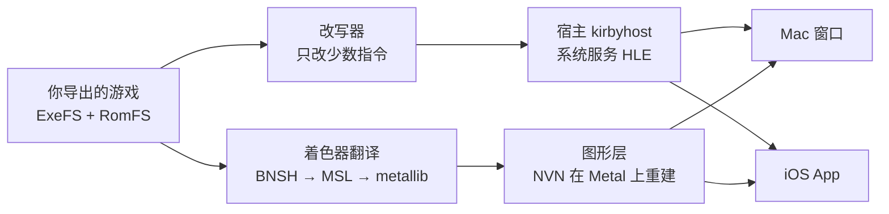

# nvn-metal

**把你自己购买的 Switch 版《星之卡比 探索发现》原生跑在 Mac 和 iPhone 上。** 不是模拟器：游戏自己的 ARM64 代码直接在苹果芯片上执行，Switch 的 NVN 图形接口在 Metal 上重建。

平台：Mac（Apple 芯片，可以正常玩）· iPhone（iOS 26 起，开发中）· 游戏版本：v1.0.0 · 中文 / English · 许可证：MIT · **需要自备游戏文件**

English: [README.en.md](README.en.md)

<!--
截图放在 GitHub Release 的附件里（像 d2r-mobile 那样），再把下面换成真实链接：
<p align="center"></p>
-->

| 60 帧 | 0 条模拟指令 | 16985 个 | 2 人 |
|:---:|:---:|:---:|:---:|
| Mac 上的关卡帧率（原版 30） | 跑的就是原版程序 | 着色器，全部离线翻译成 Metal | Mac 上本地双人，各用各的手柄 |

## 法律声明

**你必须拥有正版游戏。** 请只配合你自己购买的游戏、从你自己的 Switch 导出的数据使用本项目。这是一个独立的非商业项目，与任天堂没有关联，也未获其认可或赞助。《星之卡比》《Kirby》和 Nintendo Switch 是任天堂的商标。

- **不含、也不分发任何游戏内容**：仓库里没有游戏程序、美术、文字、音频、着色器或密钥，也**不带任何解密代码**：从游戏包取文件交给外部工具 hactool，用的是你自己主机的密钥。游戏需要的一切，都在你自己的电脑上、用你自己导出的文件现做出来。
- 仓库里有的是让移植能运行的接口信息：补丁代码、符号名、地址、着色器的键和统计数字，见 [`analysis/`](analysis) 和 [NOTICE.md](NOTICE.md)。
- 构建出的 App 和工作区里含有游戏内容，只供你自己使用，**请不要分享**。
- 导出游戏数据是否合法取决于你所在地区的法律，请自行确认并遵守。
- **附带或索要游戏文件、密钥、安装包的 issue 和 PR 会被直接删除。**

Apple、Mac、iPhone 和 Metal 是 Apple Inc. 的商标，本项目与苹果没有关联。

## 这是什么，不是什么

**是：**

- 一个技术探索：Switch 和苹果芯片都是 ARM64，能不能不经模拟器、让 Switch 游戏的程序直接在 Mac 和 iPhone 上跑？卡比是一个 3D、用满 NVN 的完整商业游戏，拿它来检验。
- 游戏程序**原样执行**，只改写极少数在苹果内核下不能直接执行的指令，改写前后逐条做等价核对。系统调用、文件、音频、输入由一个小宿主按 SDK 函数接管（HLE）；NVN 图形在 Metal 上重写；着色器离线翻译成 Metal。
- 基于 [d2r-mobile](https://github.com/jhaizhou-ops/d2r-mobile)（《暗黑破坏神 II：狱火重生》的 iOS 兼容层）的通用宿主和图形层，卡比需要的部分以补丁和独立文件的形式放在这里。

**不是：**

- 不是模拟器，也不是云游戏或串流。
- 不提供安装包或任何游戏文件。
- 不支持联机，游戏完全离线运行。

## 现在到哪一步

| 功能 | Mac（Apple 芯片） | iPhone |
|---|---|---|
| 进关卡游玩 | ✅ | ✅ 第一关 3D 场景 |
| 帧率 | ✅ 关卡 60 帧（原版 30，`KIRBY_FPS=30` 可退回） | 30 帧（原版帧率） |
| 游戏声音 | ✅ | 🚧 修法和 Mac 相同，待真机验证 |
| 过场动画、教程视频 | ✅ VP9 硬解 + Vorbis 音轨 | 🚧 只放黑帧 |
| 操作 | ✅ 键盘可改键、Xbox / PS / Switch Pro 手柄 | ✅ 屏幕手柄 + 实体手柄 |
| 本地双人 | ✅ 1P / 2P 各一套键位和手柄（加入流程还没测到） | — |
| 走动、新场景的卡顿 | ✅ 异步建管线后基本消除 | 🚧 修法已有，待真机验证 |
| 画面 | ✅ | 🚧 进城后贴图乱飞，正在查 |
| 内存 | ✅ 没遇到问题 | 🚧 余量只有约 145 MB |

Mac 上已经可以从头玩下去；iPhone 上能进第一关，还在解决卡顿、贴图和内存。逐项原因和下一步见[开发方向](#开发方向)。

## 实测数据

| 项 | 读数 |
|---|---|
| Mac 关卡帧时间 | p50 **16.67 ms**（原版 33.33 ms），GPU 每帧约 4 ms |
| Mac 卡顿（同存档、同按键脚本 A/B，各 100 秒） | 建管线卡住总时间 527 → **79 ms**，最长一帧 348 → **94 ms** |
| Mac 过场视频 | 1080p VP9 硬解每帧约 2.8 ms |
| iPhone 关卡 | 站着不动稳定 30 帧，1080p 模式下 GPU 每帧约 18.6 ms |
| 着色器库 | 16985 份全部翻译出库，另有约 1.5 万个整数变体；只跳过 10 份几何着色器 |
| 改写 | `main`、`sdk`、`subsdk0` 三个模块全部通过结构与等价核对 |

<sub>Mac：M5（10 核），macOS 27，2026-10-22 至 10-23。iPhone：iPhone 16 Pro Max，iOS 27.2，2026-10-17。</sub>

## 怎么做到的



| 部分 | 位置 | 做什么 |
|---|---|---|
| 导入与改写 | `tools/`，上游 `dm/tools/patch_nso.py` | 导入你导出的目录；只改写线程指针、系统调用、计时器这类指令，其余逐字节不动，改完逐条核对等价 |
| 宿主 | `host/`，上游 `dm/host` | 装载改写后的程序，接管它调用的 SDK 函数：文件、音频、手柄、时间、视频 |
| 图形 | 上游 `dm/gfx` + `patches/` | NVN 在 Metal 上的实现；卡比新增的 46 个接口在补丁里 |
| iOS App | `ios/` | App 外壳、屏幕手柄、出包装机 |
| 分析记录 | `analysis/`、`reports/`、`docs/` | 每个任务做了什么、怎么复现、数字是多少 |

**为什么可信：** 每一步都留了可复现的核对。三个模块的改写有结构核对和等价核对（`tools/structck_kirby.py`、`tools/equiv_kirby.py`）；导入和解包工具有回归测试（`tools/test_extractors.py`）；宿主 C 代码有 arm64 苹果目标的语法检查（`tools/syntax_check.py`）；性能改动都附 A/B 数字。每个任务一份报告，在 [`reports/`](reports)。

## 开始使用

要先有**你自己购买的游戏**：Switch 版《星之卡比 探索发现》v1.0.0（Title ID `01004D300C5AE000`，没有更新包）。

**一条命令（Mac）：**

```bash
tools/setup_mac.sh <你的游戏包.xci 或 .nsp> <你的 prod.keys>     # 或：tools/setup_mac.sh --dump <ExeFS 目录> <RomFS 目录>
```

它依次做完下表的 1–4 步，编好宿主，无窗口跑 30 秒自检，最后包成能双击的 `Kirby Host.app`；中断了重跑同一条命令，从断的地方接着做。全程约 1.5 小时。

> **推荐交给 AI 助理。** 用 Claude Code、Codex 或其他 AI 助理打开这个仓库，告诉它你自己的游戏包和 `prod.keys`（或已经导出的 ExeFS / RomFS）在哪，让它照 [docs/ai_install.md](docs/ai_install.md) 做：那一页是专门写给 AI 助理的，从检查机器、跑上面那条命令到出错时怎么处理都写了。

| 步骤 | 做什么 | 要多久 |
|---|---|---|
| 1. 取出游戏文件 | 有游戏包（`.xci` / `.nsp`）和 `prod.keys`：`tools/extract_game.sh <游戏包> <prod.keys>`，由 hactool 拆包，自动核对是不是 v1.0.0 并导入工作区。已经用 nxdumptool 等工具导出了 ExeFS / RomFS：`tools/import_dump.py` 导入 | 十几分钟 |
| 2. 准备上游 | 检出 d2r-mobile 的 `6a2474d`，套上 `patches/d2r-mobile-kirby.patch` | 1 分钟 |
| 3. 改写 | 改写三个模块并核对 | 几分钟 |
| 4. 着色器库 | 翻译出库，再编成 macOS 版 metallib（约 3.8 万次编译） | M5 上约 1 小时，只做一次 |
| 5. 开玩 | Mac：双击 `~/kirby-work/Kirby Host.app`（`tools/mac_app.sh` 出包），或 `make -C host && host/run_mac.sh`；iPhone：`ios/run.sh build && ios/run.sh install && ios/run.sh run` | — |

每一步的完整命令见 [docs/build.md](docs/build.md)；Mac 上的键位、存档位置、声音和视频的说明见 [docs/mac.md](docs/mac.md)；iPhone 的签名和装机见 [ios/README.md](ios/README.md)。

**需要准备：** Apple 芯片的 Mac，Xcode 26（图形层用 Metal 4）；Homebrew 的 `dotnet spirv-cross llvm`；Python 3 和 `capstone lz4 zstandard unicorn`；从游戏包取文件还要 [hactool](https://github.com/SciresM/hactool)（按它的说明 `make`，放进 `PATH`）。装到 iPhone 还要 `xcodegen`、Metal 工具链和一个 Apple ID（免费的也行，每 7 天要重签）。

**第一次玩到新场景时会卡一下**：没见过的渲染管线要当场编，Mac 上默认放到后台编、跳过这一帧，玩过的会记下来，下次启动先编好。

## 已知限制

| 项 | 现状 |
|---|---|
| 游戏版本 | 只做了 v1.0.0；改写规则和地址按构建号绑定，别的版本要重新适配 |
| `tools/setup_mac.sh` | 2026-11-04 新加，只在模拟的 macOS 环境里测过流程（跳过、续跑、各步出错）；里面每一步的命令都是 2026-10-22 在 M5 上实际跑通过的，但整条脚本还没在真 Mac 上从头跑过 |
| `tools/extract_game.sh` | 2026-10-30 新加，照 d2r-mobile 的做法写，只用模拟的 hactool 测过；`.nsp` 的标题密钥那一步尤其没验过，跑通或跑不通都欢迎告诉我们。已经验过的路是导出目录再 `import_dump.py` |
| iPhone 机型 | 只在 iPhone 16 Pro Max 上测过，编译目标目前是 A18 |
| iPhone 内存 | 免费 Apple ID 没有「提高内存上限」权限，余量很紧；付费开发者账号能缓解 |
| iOS 视频 | iOS 没有 VP9 硬解入口，过场动画先空播 |
| 几何着色器 | 10 份跳过 |
| 联机 | 不在范围内 |

## 开发方向

**近期：让 iPhone 追上 Mac**

- [ ] 真机验证异步建管线和启动预热，解决走动卡顿
- [ ] 查清进城后贴图乱飞（怀疑带骨骼的模型选错了着色器变体）
- [ ] 修 `nvnTextureInitialize` 重新初始化时的泄漏，压内存
- [ ] iOS 上的过场视频：VP9 软解
- [ ] 截图方向、深度截断（depth clamp）

**中期：让别人也能装起来**

- [ ] 一条命令从导出目录做到能玩，加一份给 AI 助理的安装说明（2026-11-04 已有 `tools/setup_mac.sh` 和 [docs/ai_install.md](docs/ai_install.md)，待真 Mac 上从头跑通）
- [ ] Mac 上打包成可以双击的 `.app`，窗口标题和菜单换成自己的（2026-11-04 已有 `tools/mac_app.sh` 和 `host/kirby_app.m`，待真 Mac 上验证；现在的包只能在构建它的那台 Mac 上用）
- [ ] 共享管线清单：大家玩过记下的 `pso_user.tsv`（只有管线的键和格式，不含游戏数据）汇总进仓库，所有人首次进场景都不卡
- [ ] 支持更多 iPhone 机型（A16 / A17）
- [ ] 本地双人的加入流程实测

**长期**

- [ ] 跟上 d2r-mobile 最新的 `main`（目前补丁有 6 个文件冲突）
- [ ] 游戏更新后的版本
- [ ] iPad

## 参与与反馈

- 遇到问题请开 issue，写清机器、系统版本、做到哪一步，附上日志（Mac 在 `~/kirby-work/mac/runN.txt`，iPhone 在 App 的 `Documents/boot.txt`）。
- 在别的机型上跑通或跑不通，都值得告诉我们。
- 想改代码：先读 [docs/development.md](docs/development.md) 里的开发约定和调试方法。
- 再说一次：**不要在 issue、PR 里附带或索要游戏文件、密钥、安装包。**

## 文档索引

| 说明 | 讲什么 |
|---|---|
| [docs/ai_install.md](docs/ai_install.md) | 给 AI 助理的安装说明：一条命令装到能玩、出错怎么办 |
| [docs/build.md](docs/build.md) | 从你导出的游戏开始，全在 Mac 上构建的完整命令（`tools/setup_mac.sh` 做的就是这些） |
| [docs/mac.md](docs/mac.md) | 在 Mac 上玩：键位、双人、存档、声音、视频、60 帧、卡顿的来龙去脉 |
| [ios/README.md](ios/README.md) | iOS App：签名、出包、装机、推 RomFS |
| [docs/development.md](docs/development.md) | 开发约定、测试变量、调试的坑、iPhone 端进度、游戏的已知事实 |
| [docs/handoff.md](docs/handoff.md) | 换一台电脑接着开发：工作区要拷哪些 |
| [docs/gfx.md](docs/gfx.md) · [docs/shaders.md](docs/shaders.md) · [docs/audio.md](docs/audio.md) | 图形接口、着色器库、声音的设计说明 |
| [TASKS.md](TASKS.md) · [reports/](reports) | 任务清单和每个任务的报告 |

## 致谢

- **[d2r-mobile](https://github.com/jhaizhou-ops/d2r-mobile)**（MIT）开发了这套原生运行 Switch 游戏的方法：NSO 改写器、宿主和 Metal 上的 NVN 层都来自它的通用部分。
- **Ryujinx**（MIT）：上游着色器翻译器 `dmsh_xlate` 用到它的着色器翻译代码。
- **[SPIRV-Cross](https://github.com/KhronosGroup/SPIRV-Cross)**（Apache-2.0）：把 SPIR-V 转成 Metal 着色语言。
- **[stb_vorbis](https://github.com/nothings/stb)**（公有领域 / MIT）：过场动画的 Vorbis 音轨。
- **[hactool](https://github.com/SciresM/hactool)**（ISC）：`tools/extract_game.sh` 用它从你的游戏包取文件；它不随本仓库提供。
- **[MacNativeGames](https://github.com/ly05010419/MacNativeGames)**：同样基于 d2r-mobile、把多款 Switch 游戏带到 Mac 的项目，README 写法和共享清单的思路参考了它。

## 许可证

MIT，见 [LICENSE](LICENSE)。其中来自 d2r-mobile 的部分版权所有 (c) 2026 jhaizhou，卡比移植部分版权所有 (c) 2026 MayBAMemory；详见 [NOTICE.md](NOTICE.md)。
